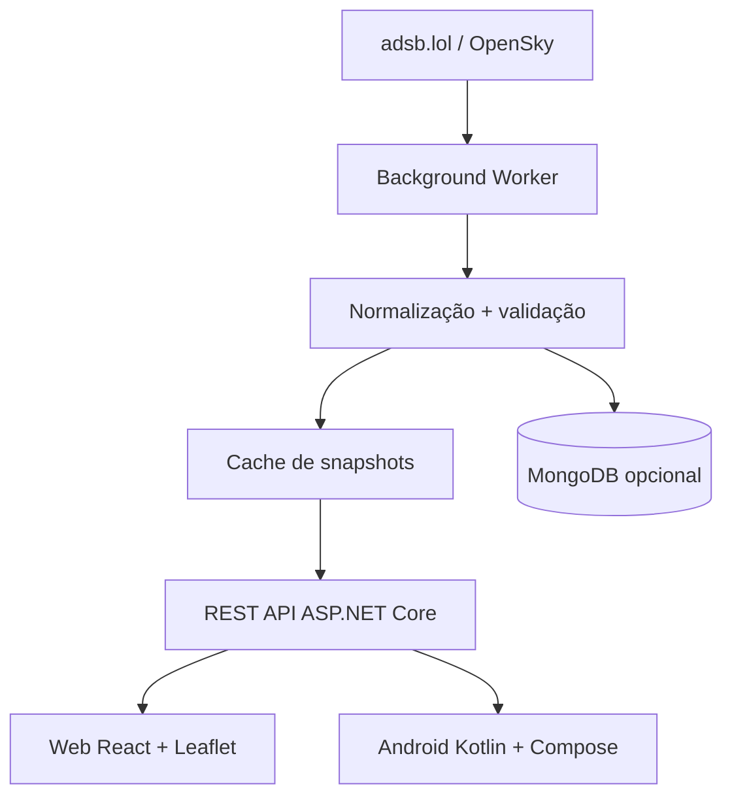

# Tráfego Aéreo Agora — Guia de implementação Web e Mobile

**Versão:** 1.0  
**Data:** 23-10-2026  
**Âmbito:** consulta e visualização de aeronaves sobre Portugal, com integração inicial de dados ADS-B através de `adsb.lol` e alternativa OpenSky Network.

> **Nota:** endpoints, limites de utilização, licenças e políticas de atribuição devem ser confirmados na documentação oficial antes de disponibilizar o serviço em produção. Posições ADS-B não garantem cobertura completa, identificação comercial nem dados de origem/destino.

## 1. Objetivos

Implementar uma funcionalidade de tráfego aéreo para:
- **Web:** React + TypeScript + Vite + Leaflet.
- **Android:** Kotlin + Jetpack Compose + Google Maps SDK ou MapLibre.
- **Backend partilhado:** ASP.NET Core (.NET 8 ou superior), com cache e normalização.
- **Persistência opcional:** MongoDB 4.4 para histórico agregado, evitando guardar indefinidamente todos os pontos.

O MVP deve permitir visualizar aeronaves sobre Portugal continental, Açores e Madeira, selecionar uma aeronave e consultar identificação, altitude, velocidade, rumo, última atualização e trajetória recente (se disponível).

## 2. Fontes de dados

| Fonte | Utilização | URL |
|---|---|---|
| adsb.lol | Posições ADS-B, consulta por centro e raio | https://api.adsb.lol/docs |
| OpenSky Network | Alternativa com consulta por bounding box | https://openskynetwork.github.io/opensky-api/rest.html |
| Airplanes.live | Alternativa de dados ADS-B | https://airplanes.live/api-docs/ |

### 2.1 Consulta inicial — adsb.lol

```bash
curl 'https://api.adsb.lol/v2/lat/38.72/lon/-9.14/dist/200'
```

A distância `dist` é expressa em milhas náuticas, conforme documentação do fornecedor. Não usar uma única consulta centrada em Lisboa para assumir cobertura de todo o território português. Definir regiões/centros distintos e deduplicar pelo identificador ICAO.

### 2.2 Consulta alternativa — OpenSky

```bash
curl 'https://opensky-network.org/api/states/all?lamin=36.8&lomin=-9.6&lamax=42.2&lomax=-6.1'
```

O exemplo cobre aproximadamente Portugal continental; para Açores e Madeira são necessárias outras caixas geográficas. A autenticação e os limites variam com o plano e a política atual.

### 2.3 Campos ADS-B típicos

| Campo normalizado | Significado | Observações |
|---|---|---|
| `icao24` | Identificador ICAO hexadecimal | Identificador principal, quando disponível |
| `callsign` | Indicativo de chamada | Pode ser nulo |
| `latitude`, `longitude` | Posição geográfica | Rejeitar valores inválidos |
| `altitudeMeters` | Altitude em metros | Confirmar altitude barométrica/geometria na origem |
| `groundSpeedKmh` | Velocidade sobre o solo | Converter unidades na camada de integração |
| `headingDegrees` | Rumo | 0–360° |
| `verticalRateMps` | Taxa de subida/descida | Opcional |
| `onGround` | Em terra | Opcional |
| `lastSeenUtc` | Instante do último sinal | Essencial para detetar dados desatualizados |
| `source` | Fonte | Rastreabilidade |

**Atenção:** os nomes exatos e as unidades do JSON bruto variam por fornecedor. A camada de adaptação deve tratar campos ausentes e formatos distintos. `callsign` não identifica necessariamente um número de voo comercial; origem/destino, companhia, atrasos e horários não são garantidos pelos feeds ADS-B.

## 3. Arquitetura



**Princípio:** web e mobile nunca devem depender diretamente do formato de cada fornecedor. Um backend central reduz chamadas, centraliza regras de utilização, protege credenciais quando necessárias e oferece contratos estáveis.

## 4. Contrato REST interno

Base: `/api/v1/air-traffic`

| Método | Endpoint | Função |
|---|---|---|
| GET | `/aircraft?region=mainland` | Snapshot das aeronaves da região |
| GET | `/aircraft?region=azores` | Snapshot dos Açores |
| GET | `/aircraft?region=madeira` | Snapshot da Madeira |
| GET | `/aircraft/{icao24}` | Última posição e detalhes |
| GET | `/aircraft/{icao24}/track?minutes=30` | Trajetória, apenas se recolhida |
| GET | `/stats?region=mainland` | Estatísticas do snapshot |
| GET | `/health` | Estado da API |

### 4.1 Exemplo de resposta

```json
{
  "region": "mainland",
  "generatedAtUtc": "2026-10-23T10:00:00Z",
  "source": "adsb.lol",
  "isStale": false,
  "aircraft": [
    {
      "icao24": "4ca123",
      "callsign": "EXAMPLE123",
      "latitude": 38.72,
      "longitude": -9.14,
      "altitudeMeters": 10500,
      "groundSpeedKmh": 780,
      "headingDegrees": 210,
      "verticalRateMps": null,
      "onGround": false,
      "lastSeenUtc": "2026-10-23T09:59:52Z"
    }
  ]
}
```

Valores **fictícios** e apenas ilustrativos.

## 5. Backend ASP.NET Core

### 5.1 Estrutura sugerida

```text
src/
  AirTraffic.Api/
    Controllers/
    Contracts/
    Services/
    Providers/
      IAircraftProvider.cs
      AdsbLolProvider.cs
      OpenSkyProvider.cs
    Workers/
      AircraftRefreshWorker.cs
    Cache/
    Persistence/
    Program.cs
```

### 5.2 Configuração

```json
{
  "AirTraffic": {
    "Provider": "AdsbLol",
    "RefreshSeconds": 60,
    "StaleAfterSeconds": 180,
    "HttpTimeoutSeconds": 15,
    "Regions": {
      "mainland": [{ "lat": 38.72, "lon": -9.14, "distNm": 200 }],
      "azores": [{ "lat": 37.74, "lon": -25.67, "distNm": 200 }],
      "madeira": [{ "lat": 32.75, "lon": -16.96, "distNm": 150 }]
    }
  }
}
```

**Nota de cobertura:** estas regiões são exemplos para desenvolvimento, não uma configuração exaustiva. Adicionar centros para norte/sul do continente e várias ilhas dos Açores; confirmar os limites aceites pelo fornecedor.

### 5.3 Modelos C#

```csharp
public sealed record AircraftDto(
    string Icao24,
    string? Callsign,
    double Latitude,
    double Longitude,
    double? AltitudeMeters,
    double? GroundSpeedKmh,
    double? HeadingDegrees,
    double? VerticalRateMps,
    bool? OnGround,
    DateTimeOffset LastSeenUtc);

public sealed record AircraftSnapshotDto(
    string Region,
    DateTimeOffset GeneratedAtUtc,
    string Source,
    bool IsStale,
    IReadOnlyList<AircraftDto> Aircraft);

public interface IAircraftProvider
{
    Task<IReadOnlyList<AircraftDto>> GetAircraftAsync(
        string region, CancellationToken cancellationToken);
}
```

### 5.4 Regras de integração

1. Criar um `HttpClient` através de `IHttpClientFactory` com timeout configurável.
2. Consultar cada centro geográfico com controlo de concorrência.
3. Validar resposta HTTP e JSON; ignorar aeronaves sem coordenadas válidas.
4. Converter altitude, velocidade e timestamps para unidades internas explícitas.
5. Deduplicar por `icao24`, preservando o registo mais recente.
6. Guardar o último snapshot válido em cache (`IMemoryCache` num único servidor; Redis opcional em várias instâncias).
7. Quando o fornecedor falhar, devolver o último snapshot com `isStale=true` e respetiva idade.
8. Aplicar backoff em 429/5xx; nunca criar loops de polling por utilizador.
9. Configurar logs estruturados sem credenciais ou dados sensíveis.
10. Não assumir que a licença da fonte permite redistribuição pública sem restrições.

### 5.5 Worker

Utilizar `BackgroundService` com `PeriodicTimer`, isolamento por região, `CancellationToken`, tratamento de exceções e prevenção de execuções sobrepostas. Começar com 60 segundos apenas como **configuração de teste**; ajustar aos termos e quotas do fornecedor.

## 6. Web — React + Vite + Leaflet

### 6.1 Dependências

```bash
npm install leaflet react-leaflet
npm install -D @types/leaflet
```

### 6.2 Serviço de dados

```typescript
export interface Aircraft {
  icao24: string;
  callsign: string | null;
  latitude: number;
  longitude: number;
  altitudeMeters: number | null;
  groundSpeedKmh: number | null;
  headingDegrees: number | null;
  verticalRateMps: number | null;
  onGround: boolean | null;
  lastSeenUtc: string;
}

export interface AircraftSnapshot {
  region: string;
  generatedAtUtc: string;
  source: string;
  isStale: boolean;
  aircraft: Aircraft[];
}

export async function getAircraft(region = "mainland"):
  Promise<AircraftSnapshot> {
  const response = await fetch(
    `/api/v1/air-traffic/aircraft?region=${encodeURIComponent(region)}`
  );
  if (!response.ok) throw new Error(`HTTP ${response.status}`);
  return response.json();
}
```

### 6.3 Componente de mapa (exemplo)

```tsx
import { MapContainer, TileLayer, Marker, Popup } from "react-leaflet";
import L from "leaflet";
import type { Aircraft } from "./airTrafficApi";

export function AircraftMap({ aircraft }: { aircraft: Aircraft[] }) {
  return (
    <MapContainer center={[39.5, -8]} zoom={7}
      style={{ height: "70vh", width: "100%" }}>
      <TileLayer
        attribution='&copy; OpenStreetMap contributors'
        url="https://{s}.tile.openstreetmap.org/{z}/{x}/{y}.png"
      />
      {aircraft.map(a => (
        <Marker key={a.icao24} position={[a.latitude, a.longitude]}
          icon={L.divIcon({ html: "✈️", className: "aircraft-icon" })}>
          <Popup>
            <strong>{a.callsign ?? a.icao24}</strong>
            <div>Altitude: {a.altitudeMeters ?? "N/D"} m</div>
            <div>Velocidade: {a.groundSpeedKmh ?? "N/D"} km/h</div>
          </Popup>
        </Marker>
      ))}
    </MapContainer>
  );
}
```

Importar `leaflet/dist/leaflet.css` na aplicação. Para produção, substituir o emoji por ícone vetorial orientado segundo `headingDegrees`, usar clustering ou Canvas para muitos aviões e verificar a política do fornecedor de tiles OSM.

### 6.4 Funcionalidades de UI

- Seleção Continental / Açores / Madeira.
- Contagem de aeronaves e indicação da última atualização.
- Pesquisa por ICAO ou callsign.
- Filtros por altitude, velocidade e estado em terra.
- Painel lateral com detalhes da aeronave selecionada.
- Estado de carregamento, erro e dados desatualizados.
- Atualização automática configurável, preferencialmente via TanStack Query.
- Acessibilidade: navegação por teclado, contraste e alternativa textual ao mapa.

## 7. Android — Kotlin + Jetpack Compose

### 7.1 Tecnologias

- Kotlin + Jetpack Compose + Material 3.
- Retrofit + OkHttp + kotlinx.serialization ou Moshi.
- Hilt para injeção de dependências.
- ViewModel + StateFlow.
- Google Maps Compose ou MapLibre para o mapa.
- Room opcional para favoritos, pesquisas e histórico local.

### 7.2 DTO e Retrofit

```kotlin
data class AircraftDto(
    val icao24: String,
    val callsign: String?,
    val latitude: Double,
    val longitude: Double,
    val altitudeMeters: Double?,
    val groundSpeedKmh: Double?,
    val headingDegrees: Double?,
    val verticalRateMps: Double?,
    val onGround: Boolean?,
    val lastSeenUtc: String
)

data class AircraftSnapshotDto(
    val region: String,
    val generatedAtUtc: String,
    val source: String,
    val isStale: Boolean,
    val aircraft: List<AircraftDto>
)

interface AirTrafficApi {
    @GET("api/v1/air-traffic/aircraft")
    suspend fun getAircraft(
        @Query("region") region: String
    ): AircraftSnapshotDto
}
```

### 7.3 Repository

```kotlin
class AirTrafficRepository(private val api: AirTrafficApi) {
    suspend fun getAircraft(region: String): AircraftSnapshotDto =
        api.getAircraft(region)
}
```

### 7.4 ViewModel

```kotlin
sealed interface AirTrafficUiState {
    data object Loading : AirTrafficUiState
    data class Success(val data: AircraftSnapshotDto) : AirTrafficUiState
    data class Error(val message: String) : AirTrafficUiState
}

class AirTrafficViewModel(
    private val repository: AirTrafficRepository
) : ViewModel() {
    private val _state = MutableStateFlow<AirTrafficUiState>(AirTrafficUiState.Loading)
    val state = _state.asStateFlow()

    fun load(region: String) = viewModelScope.launch {
        _state.value = AirTrafficUiState.Loading
        _state.value = try {
            AirTrafficUiState.Success(repository.getAircraft(region))
        } catch (e: Exception) {
            AirTrafficUiState.Error(e.message ?: "Erro de comunicação")
        }
    }
}
```

Para produção, acrescentar polling apenas com o ecrã visível, cancelamento com ciclo de vida, preservação do snapshot anterior, retry controlado e injeção de dependências via Hilt. O código acima ilustra o contrato e não inclui todos os imports/configuração Gradle.

### 7.5 Ecrãs Android

1. **Mapa:** aeronaves, seletor de região, contagem e atualização.
2. **Detalhe:** identificação, velocidade, altitude, rumo e idade dos dados.
3. **Pesquisa:** ICAO, callsign e aeronaves visíveis.
4. **Definições:** unidades (km/h, nós; metros, pés), região e frequência visual.
5. **Favoritos (fase 2):** aeronaves/callsigns guardados localmente.

Não é necessário solicitar a localização do telemóvel para mostrar o tráfego aéreo nacional. Pedir permissão de localização apenas se o utilizador ativar explicitamente a funcionalidade “aviões perto de mim”.

## 8. Persistência MongoDB 4.4 (opcional)

Coleções:

```text
aircraft_latest
  _id: icao24
  callsign, latitude, longitude, altitudeMeters,
  groundSpeedKmh, headingDegrees, lastSeenUtc, updatedAtUtc

aircraft_track_points
  _id, icao24, location: { type: "Point", coordinates: [lon, lat] },
  altitudeMeters, recordedAtUtc

air_traffic_stats_hourly
  _id, region, hourUtc, aircraftCount, source
```

Índices sugeridos:

```javascript
db.aircraft_latest.createIndex({ lastSeenUtc: -1 });
db.aircraft_track_points.createIndex({ icao24: 1, recordedAtUtc: -1 });
db.aircraft_track_points.createIndex({ recordedAtUtc: 1 }, { expireAfterSeconds: 86400 });
db.aircraft_track_points.createIndex({ location: "2dsphere" });
db.air_traffic_stats_hourly.createIndex({ region: 1, hourUtc: -1 });
```

O TTL de 24 horas é ilustrativo. Confirmar permissões de retenção e redistribuição antes de armazenar dados brutos; para estatísticas históricas, preferir agregados. O índice TTL apaga documentos em segundo plano, não exatamente no segundo da expiração.

## 9. Segurança, conformidade e custos

- Nunca guardar tokens de fornecedores no JavaScript do browser nem no APK.
- Aplicar rate limiting à API interna, CORS restrito e HTTPS.
- Usar quotas e caching para proteger o fornecedor externo.
- Registar a origem dos dados e a hora da última receção.
- Mostrar aviso de que a informação pode estar incompleta ou atrasada.
- Confirmar termos de serviço, atribuição, limites de chamadas, redistribuição e uso comercial de cada fornecedor.
- Verificar licenciamento e política de utilização dos mapas/tiles.
- Não utilizar o sistema para navegação aeronáutica, segurança operacional ou decisões críticas.

## 10. Testes

| Tipo | Cenários |
|---|---|
| Unitários | Conversão de unidades, timestamps, deduplicação, coordenadas inválidas |
| Integração | HTTP 200, 429, 500, timeout, JSON incompleto |
| Cache | Atualização, concorrência, stale snapshot, fallback |
| Web | Mapa, filtros, pesquisa, loading/erro, mobile responsive |
| Android | Rotação, background/foreground, perda de rede, permissões |
| Performance | Centenas/milhares de marcadores, consumo de memória, polling |
| Contrato | Compatibilidade DTO backend/web/mobile |

## 11. Roadmap

### Fase 1 — MVP
- Validar termos de uso do fornecedor.
- Criar adaptador adsb.lol e cache no backend.
- Disponibilizar endpoint `/aircraft` e `/stats`.
- Criar mapa React com atualização periódica.
- Criar mapa Android e detalhe da aeronave.

### Fase 2 — Melhorias
- Cobertura geográfica de Portugal completo e deduplicação multi-centro.
- Filtros avançados, pesquisa e rotação de ícones.
- Fallback OpenSky e observabilidade.
- Histórico de trajetórias com retenção controlada.

### Fase 3 — Dados de voos
- Integrar fornecedor específico de horários, chegadas, partidas, atrasos e origem/destino.
- Correlacionar callsign/ICAO com voos, sinalizando correspondências incertas.
- Adicionar aeroportos portugueses, estatísticas e notificações opcionais.

## 12. Critérios de aceitação do MVP

- O mapa web e a app Android consomem o mesmo contrato REST.
- O backend normaliza dados ADS-B e apresenta o timestamp real de receção.
- Não há chamadas diretas por cada visitante à API externa.
- Uma falha do fornecedor não causa crash e apresenta estado desatualizado.
- O utilizador consegue selecionar uma aeronave e ver os campos disponíveis.
- A UI distingue dados indisponíveis de valores zero.
- O fornecedor, atribuição e limitações estão identificados.

## 13. Referências

- adsb.lol — https://api.adsb.lol/docs
- OpenSky REST API — https://openskynetwork.github.io/opensky-api/rest.html
- Airplanes.live — https://airplanes.live/api-docs/
- Leaflet — https://leafletjs.com/
- React Leaflet — https://react-leaflet.js.org/
- ASP.NET Core — https://learn.microsoft.com/aspnet/core/
- Jetpack Compose — https://developer.android.com/compose
- Google Maps Compose — https://github.com/googlemaps/android-maps-compose
- MapLibre Native Android — https://maplibre.org/

---

**Recomendação de implementação:** começar com um backend partilhado e um único fornecedor ADS-B; acrescentar dados de horários e aeroportos numa integração separada, porque não são inerentes aos dados de posição das aeronaves.
